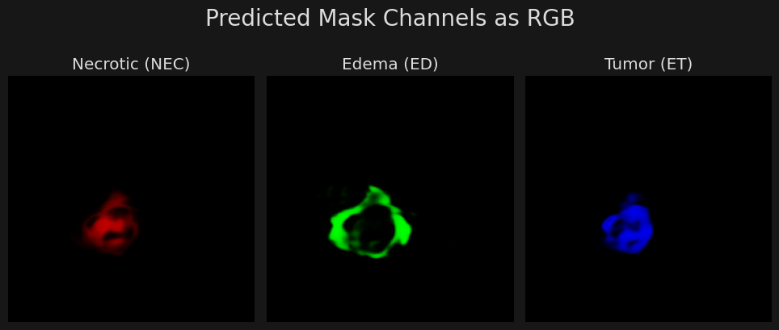
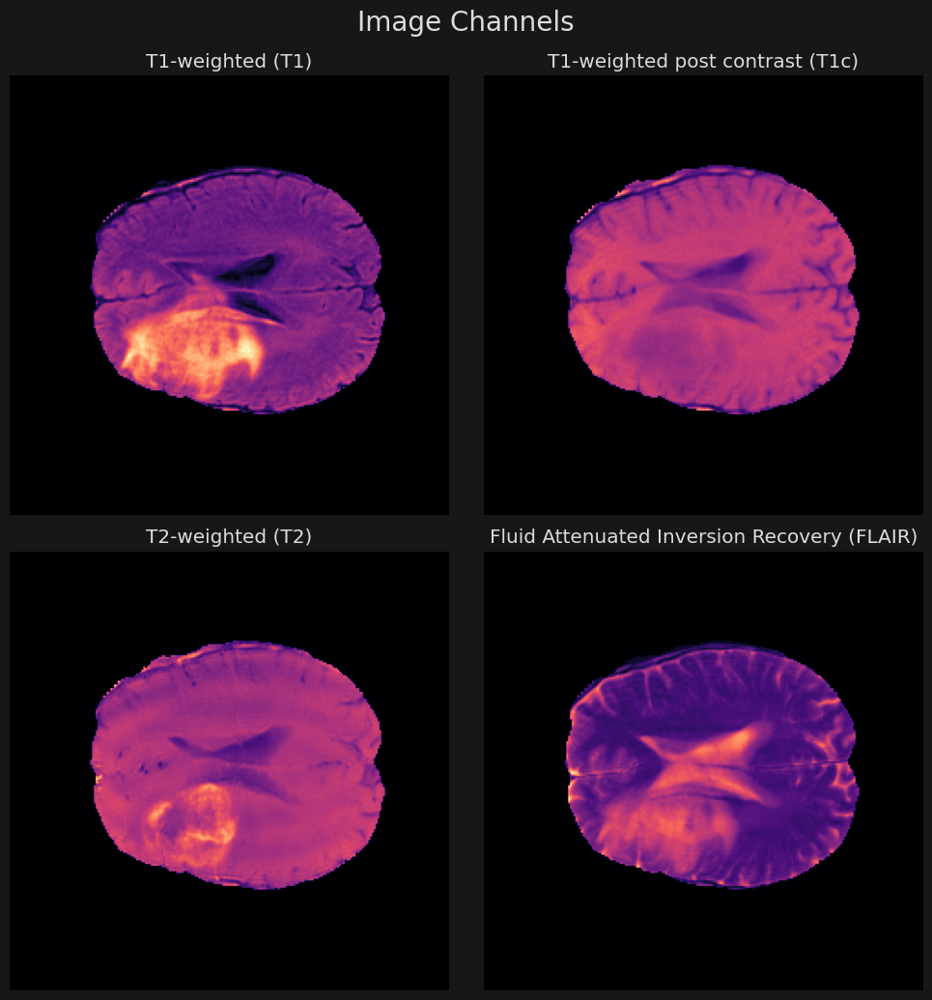
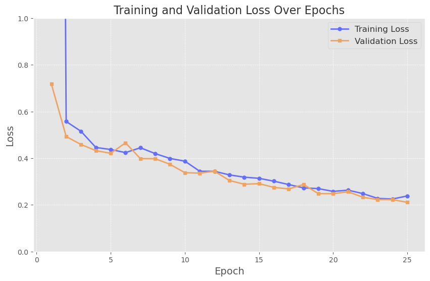
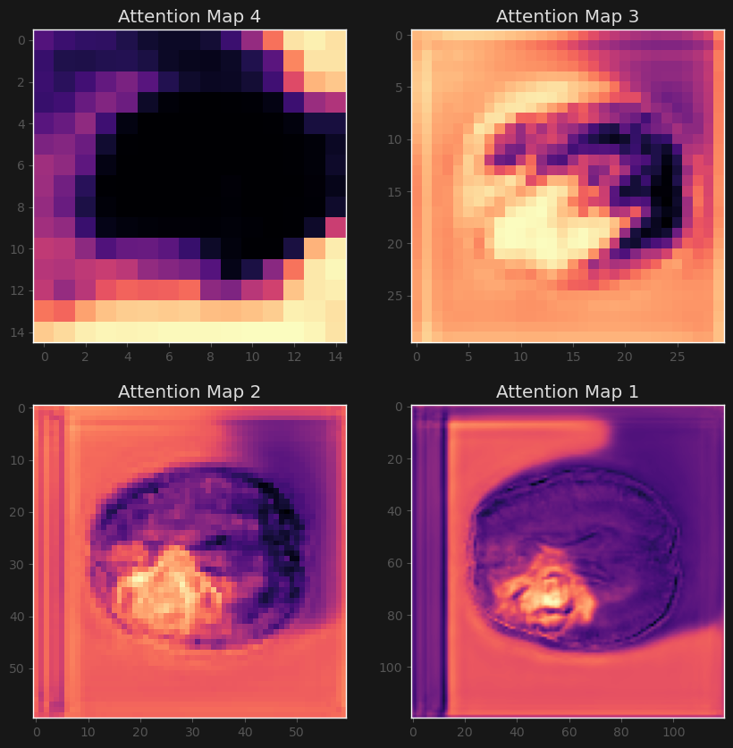

# Brain tumour segmentation

Segments three tumour sub-regions — necrotic core, edema and enhancing tumour — from multimodal brain MRI. Three architectures are trained and compared, ending with an Attention U-Net whose attention gates are visualised to see what the network looks at.



## Data

Each sample is a 240 × 240 axial slice with four MRI sequences stacked as channels (T1, T1 post-contrast, T2, FLAIR) and a three-channel mask, one channel per tumour sub-region. Slices are read from HDF5 files.



## Experiments

| Model | Parameters | Training | Outcome |
|---|---|---|---|
| U-Net | ~5.5 M | 12 epochs | Finds the tumour area, cannot separate sub-regions |
| Slimmer U-Net + learning-rate decay | ~3 M | 12 epochs | Lower validation loss with half the parameters, sharper edges |
| Attention U-Net (residual attention blocks) | ~3 M | 25 epochs | Validation loss about half of the first model; sub-regions clearly separated |

All models are trained with Adam and binary cross-entropy over the three mask channels.



## What the attention gates learn



- Maps 1 and 2 (high resolution) concentrate on the tumour, with some response to the background.
- Map 3 locates the tumour region and suppresses healthy tissue.
- Map 4 (lowest resolution) attends only to the area around the brain, which suggests this pathway adds little and is a candidate for pruning.

## Run

```bash
uv sync
uv run jupyter lab brain-tumour-segmentation.ipynb
```

Set the dataset path in the **Path** cell.

## Stack

PyTorch · NumPy · h5py · Matplotlib
